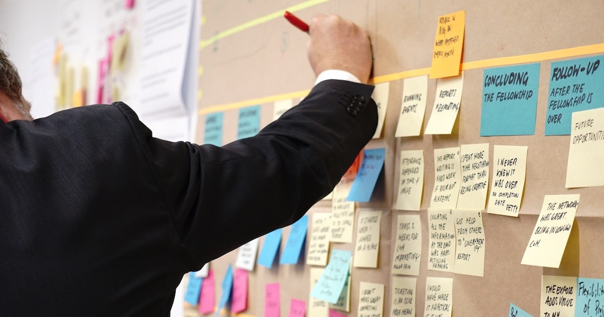

少し前に MBTI という自分の性格に関する検査を受け、その結果を元に認定ユーザーからフィードバックをいただく機会がありました。
結果だけでなく過程も含めてとても有意義な時間だったので、印象的だったことをいくつかメモしてみます。

## MBTI って？

> マイヤーズ・ブリッグス・タイプ・インディケーターは、ユングの性格タイプの考え方を理解しやすいものにし、日常の生活の場で自分のタイプを活用できるように開発された質問紙です。人の心のあり方の多様性について説明し、人間関係で起こりやすい誤解や行き違いなどについて考える手がかりを提供します。

[『MBTIタイプ入門 第６版』](https://www.amazon.co.jp/dp/4905050073) にはこのように記されています。[クリフトンストレングス](https://www.gallup.com/cliftonstrengths/ja/253634/%E3%83%9B%E3%83%BC%E3%83%A0.aspx) などの検査と同様に、数十の質問への回答を通して、4つの観点から自分の性格タイプを判定することができます。

ただし MBTI がユニークなのは、ここで判定された結果をそのまま受け入れるとも限らないところです。「認定ユーザー」と呼ばれる専門家と一緒に新たなワークショップに取り組み、そこで得た結果と最初の診断結果の両方を踏まえて自分がどのタイプに当てはまるのかを **自分で判定します。**

自分がどのタイプに当てはまるのかを最後は自分で判定する... 性格診断といえば与えられた結果をそのまま受け入れるのが当然と考えていたので、とても新鮮な感じでした。

## ワークショップってどんなことをするの？

残念ながら詳細なことは公開してはダメということなので何も書けません... そこまで難しいことをするわけではなく、シンプルな課題にありのままの自分で取り組むという感じでした。

この「ありのまま」というのが大切なキーワードで、普段仕事で使っているような考え方や性質を取っ払って取り組むように何度も指摘されました。具体的な例は後々出しますが、仕事をしていたりコミュニティーで活動しているときの自分ではない本当の（生来の）自分の考え方を曝け出すことが必要でした。

## 結果はどうだったの？

私は **ESFP** という結果になりました。これはすなわち「E：外向」「S：感覚」「F：感情」「P：知覚」という四つの性質を備えているということです（と自分で判断しました）。

『MBTIタイプ入門 第６版』にはこのタイプによく見られる（よく表れる）特徴として次のようにまとめられています：

> 人やできごとなど外界と関わることを好み、親しみやすく、人当たりがよく、人生そのものや人との関係、また五感で得られる快適さ、に喜びを覚える。周囲に働きかけながら、実際にものごとを進めることを楽しむ。仕事や、ものごとをより楽しくするために、良識的なアプローチで関わる。状況に柔軟に対応し、新しく出会う人や環境に対して、素早く適応する。他者と一緒に新しいスキルを経験しながら学ぶ。

なんだかソフトウェアエンジニアっぽくない感じがする特徴な気もしますが... それでも昔からの自分の行動とか楽しかったこと、嫌だったことを振り返ってみるととてもよく当てはまっているように感じます。寂しがりやなので、いろんなことを誰かと一緒に進めるのが好きなんです()

## T vs. F の問いにとても悩んだ

ワークショップでは四つの性質についてそれぞれワークを通して判断をしていきますが、最も迷ったのが「T：思考」なのか「F：感情」なのかという問いでした。

普段の仕事で仕様を考えたり設計をしたりするときは論理的な思考を巡らせていますが、その一方で自分や周囲の人が好きなこと・したいことは何なのかをもとに意思決定をしたいと感じることも多いです。さまざまな性格診断でもこの両面がどっち付かずに表れることが多く、MBTI の最初の診断結果でもあまりはっきりとは判定されていませんでした。

MBTI の認定ユーザーの方と色々ディスカッションをしましたが、結論は **F な性格が土台となっているが、そこに大学受験や仕事を通して論理的な思考が備わっている** ということでした。最近話題の大谷翔平よろしく、二刀流な性質が備わっているとのことでした。なるほどなるほど。

## つまるところ、とても有意義な時間でした！

T なのか F なのかという観点については少し詳しく自分自身について考えたことを載せましたが、そのほかにも三つの観点について同じようにワークに取り組み、議論し、判断しました。自分自身の理解をより深めるいい時間にすることができるため、どんな方にもとてもオススメです！

幸い私は同僚の [宮田さん（@miyacchigoronya）](https://twitter.com/miyacchigoronya) がこの MBTI 認定ユーザーで、こうした受験 & ワークショップの機会を設けていただけました。誘っていただかなかったら名前すら知らなかったものだったので.... とてもありがたかったです！
