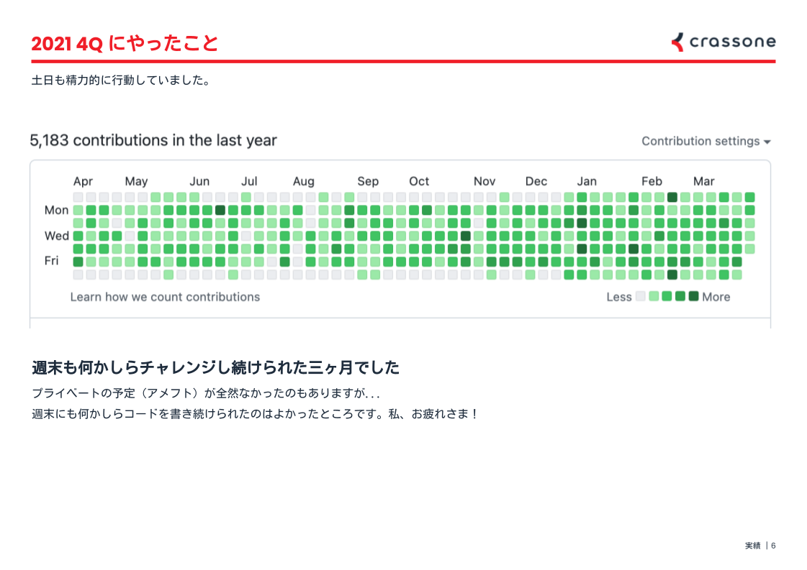
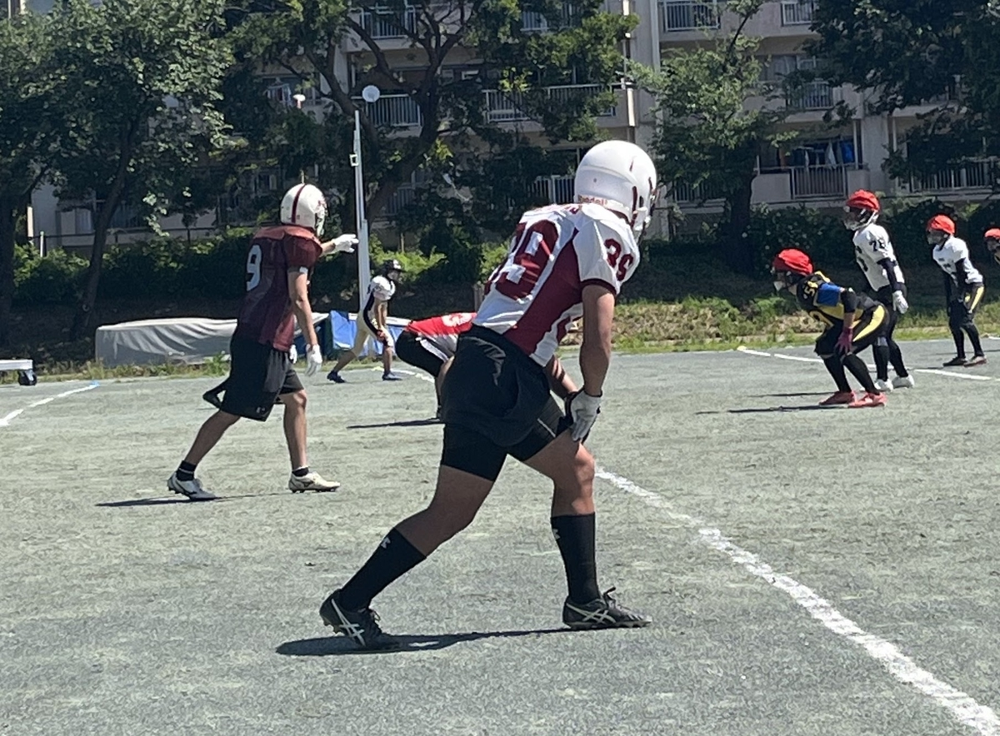

今年も無事に誕生日を迎えられて、めでたく 29 歳になりました。
もう一ヶ月くらい経ってしまっていますが、せっかくなのでいろいろと最近の変化をまとめてみます。

## プロダクトマネージャーをはじめました

新卒で入社した会社でエンジニアリングをはじめてから、これまで Ruby on Rails を中心に 6 年くらいコードを書いてきました。
とっても得意な領域はまだ作れていませんが、そこそこの規模のアプリであれば運用も含めて一通りの開発は難なくできるかなと思っています。

「そろそろ領域を絞って、技術を突き詰めていきたいな」

そんな風に思っていた矢先...
チームの都合で、エンジニアからプロダクトマネージャー（以降 PdM）に役割が変わりました。

これまで、短期的なプロジェクトの成功に向けてマネジメントを任されることはしばしばありました。
しかし書籍だったり Web の記事だったりを読む限り、PdM とはそれとはまったく異なる役割のようです。

29 歳にして、久々に本気を出して新しい領域に挑戦しています。
スポンジのように知識を吸収できていた学生の頃のようにはいきませんが...
その分寝る間も惜しんで、長い時間をかけてキャッチアップしています。

4 月に PdM になってからいろいろな本を読んできましたが、一番刺さったのはビルドトラップ本でした。
ともすると自分はエンジニア的な思考でアウトプットを重視してしまいがちだと思っていて、そうならないよう週に一度はパラパラと見返しています。
（それにしても、PdM がカバーすべき知識の範囲って広すぎませんか...？）

[プロダクトマネジメント ―ビルドトラップを避け顧客に価値を届ける](https://www.amazon.co.jp/dp/4873119251)

コーディングをする時間も一気に短くなりました。
他の人だと手に負えないような箇所はときどき担当しますが、それ以外だと本当にコードを書いていません。
4月の頭にこんな発表をしたとは思えないくらい、[最近のコントリビューション](https://github.com/yamat47) は微妙な感じですね...。

https://tech.crassone.jp/posts/mvv-award-winning-report

## アメフトは引き続きがんばっています

アメフトをはじめたのが大学一年生の頃なので、もう 10 年以上続けていることになりますね。
数年前から社会人チームのキャプテンをやっていて、変わらず学生たちのコーチもしているので、週末はずっとアメフト漬けです。

試合数が少なかったこともあって全然タッチダウンを取れていないので...
今年こそ RB で独走タッチダウンを決めます！

## 20 代最後の一年ですね

<blockquote class="twitter-tweet" data-conversation="none" data-lang="ja">
「デート 二回目 誘い方」で検索するっていう、中学生みたいなムーブしちゃった
— Takuya Yamaguchi (@yamat47) <a href="https://twitter.com/yamat47/status/1530842179324633090">2022年5月29日</a></blockquote>

<blockquote class="twitter-tweet" data-conversation="none" data-lang="ja">
勇気だしてデートに誘ったけど返信がないので、今日はもう寝ます😴
— Takuya Yamaguchi (@yamat47) <a href="https://twitter.com/yamat47/status/1531964393088745473">2022年6月1日</a></blockquote>

こんなしょうもないツイートをしている場合じゃない。
そろそろちゃんと婚活というか、相手をちゃんと探しはじめないと...

アウトカム思考でがんばります...！

そういえば全然話は変わりますが、4 月に衝撃的なニュースがありました。
学生の頃から応援してきたアイドルの子が、今年いっぱいでグループを脱退するとのことです。

<blockquote class="twitter-tweet" data-conversation="none" data-lang="ja">
本日発表させていただきました  私、柏木ひなたは 2022年12月開催予定のライブをもちまして 私立恵比寿中学を転校(脱退)いたします  最後まで応援のほど よろしくお願いいたします<a href="https://twitter.com/hashtag/%E7%A7%81%E7%AB%8B%E6%81%B5%E6%AF%94%E5%AF%BF%E4%B8%AD%E5%AD%A6?src=hash&amp;ref_src=twsrc%5Etfw">#私立恵比寿中学</a> <a href="https://twitter.com/hashtag/%E3%82%A8%E3%83%93%E4%B8%AD?src=hash&amp;ref_src=twsrc%5Etfw">#エビ中</a> <a href="https://twitter.com/hashtag/%E6%9F%8F%E6%9C%A8%E3%81%B2%E3%81%AA%E3%81%9F?src=hash&amp;ref_src=twsrc%5Etfw">#柏木ひなた</a>
— 柏木ひなた (@hi_99_na) <a href="https://twitter.com/hi_99_na/status/1510428022440366082">2022年4月3日</a></blockquote>

20 代前半の頃、幾度この子の歌声に救われてきたことか...。
これまであって当たり前だと思っていたものがなくなってしまうわけで、自分にとってはそこそこ大きな変化になりそうです。

引き続きエビ中を応援し続けるのかな、それともあんまり好きじゃなくなってしまうのかな？
いずれにせよ、そういう意味でも今年の一年は大きな節目になりそうです。
（年末のライブは絶対に行くぞ）

## おわりに

引き続き、お酒好きで人たらしな性格はまったく変わっていません。
飲み会に誘われたらいつでもどこでも飛んでいきますので、ぜひ気軽に誘ってください！

29 歳の山口拓弥もよろしくお願いします。
