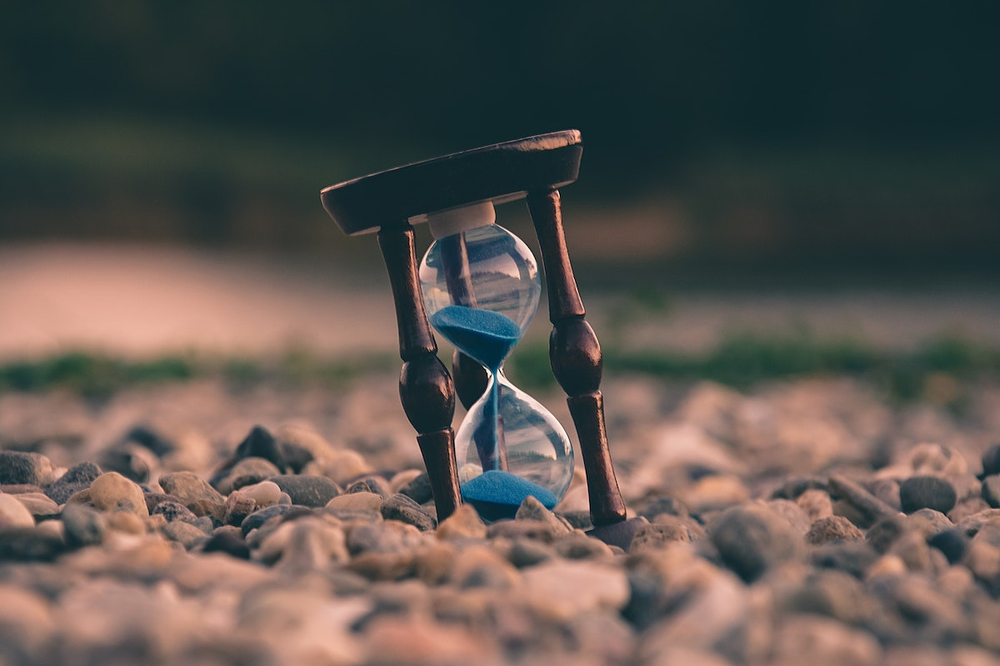

タイトルの通りなんですが。岩田健太郎さんの『1秒もムダに生きない』を最近読んで、すごくよかったのでこの想いをまとめてみます。「強く共感するところばかりだった」「自分ととても似た考え方だった」「伝え方が誠実で好感をもった」みたいな感情が入り混じっています。

<blockquote class="twitter-tweet" data-conversation="none" data-lang="ja">
『1秒もムダに生きない』を読んでいきます。  コロナがなかったら岩田さんのことをずっと知らなかっただろうし、この本にも出会わなかったと思う。そう意味では不思議な巡り合わせな気がする。 <a href="https://t.co/cLevw3LPka">pic.twitter.com/cLevw3LPka</a>
— 山口 拓弥 (@yamat47) <a href="https://twitter.com/yamat47/status/1545363079093174272">2022年7月8日</a></blockquote>

## 僕も「今、一番やりたいことを、やる」人生だった

> いろいろ模索した挙句、僕は次のような結論に至りました。
>
> それは、「今、一番やりたいことを、やる」です。緊急性があろうが、重要性があろうが、関係なし。そういうことをいちいち吟味することも特に必要ない。そのように考えるに至ったのです。

次に何をするかを考えるときに、よく「重要度」と「緊急性」の二つの軸で物事を分類するように勧められます。そして「重要だけど緊急ではないこと」「緊急だけど重要ではないこと」の狭間で悩み、揺れ動く人も多いのではと想像しています。

そんな問題に対して、著者は「今、一番やりたいことを、やる」ように勧めます。やりたいことをしているときが一番成果が出るし、着手順を考えるために一度止まってしまうと再開するためのエネルギーが余計に必要になってしまう。そうしたことを踏まえると、自分のノっている気分に逆らわず一気にやりたいことを進めてしまう方がよいだろう、ということです。

振り返ってみると、自分もこんな感じでいろいろなことに取り組んできました。高校の数学で新単元がはじまりそうになったら、初回の授業までに一気に青チャート（学校指定のものの他に使っていた問題集）を先取りして一通り解いたり... プログラミングを仕事で使う必要がでてきたら、それこそ寝食忘れて書籍や Web の記事にかじりついて手を動かし続けたり... ~~ドラクエや Ghost of Tsushima みたいな RPG を手に入れたら毎晩ほぼ徹夜でやり抜いたり...~~ 何かを思い切りやっている間は他のことには全然手をつけない、そんな過ごし方でした。

こんな性格なので、継続して何かに取り組むことが僕は本当に苦手です。毎週の英単語のテストも普通に落ちて夏休みの補講に回されるし、ウェイトトレーニングも間隔が空いてしまって強さにつながらない。最近は仕事が終わった後にカフェに来て本を読むのが習慣になっているけど、これも読みたい本がなくなったらすぐに終わる予感。「朝活毎日頑張ってます！」みたいな人も身近にいると思うんですが、僕には絶対できないのですごいなと尊敬してます。（著者の岩田さんはどうなんだろう、継続とか習慣化とか苦手じゃないんだろうか。）

また、常にやりたいことをやる人生だと、なんだかとってもエネルギーを使います。活動しているときは全力フルスロットル、ゆったり何かをすることがなく、強度が高い毎日です。著者は意図的にじっくり時間を使うタイミングを生活に仕組んでいるようなので、僕も何かしら取り入れてみようかなと思っています。（湯船に浸かってゆっくり休むところからかな）

自分の感性に従って（その代わり全速力で）過ごしていた人生ですが、それがすごく的確に言語化されていたのが強烈でした。

<blockquote class="twitter-tweet" data-conversation="none" data-lang="ja">
冒頭からしばらく「今、一番やりたいことを、やる」話をしてるけど、めっちゃ共感してる。大学受験も社会人になってからの勉強も、自分の欲求に抗うことなくそのときやりたいことを全力でやってた気がする。方向を変えながらずっと全速力で走り続けるイメージ。意外と、不思議と疲れないんだよな〜
— 山口 拓弥 (@yamat47) <a href="https://twitter.com/yamat47/status/1545363937109381121">2022年7月8日</a></blockquote>

## 「控えめな好奇心」は生きている間ずっと忘れたくない価値観

> 好奇心をなくすのもよろしくないと思います。他社に先んじて情報通になる必要はないですが、他者の対話、他者の関心ごとに遅れてついていくくらいの「控えめな好奇心」は、会話に参加するのに重要な要件だと僕は思います。それは他社に対する配慮を含んだ、控えめな好奇心ですが、単なるやじ馬根性的な軽い気持ちでも、もちろん、結構でしょう。

コーチをしているアメフトチームの学生と話すと、なんだか近頃は彼ら彼女らが興味や関心を寄せている対象のことを知らないことが増えています。そもそも年齢が離れてきていて世代間のギャップが生まれているのもありますが、より多様な価値観・さまざまな趣味趣向を持った子たちに囲まれるようになっていることもありそうです。

コーチたるもの、アメフトを通じて学生たちにさまざまなことを伝えなければなりません。技術に関する指導はもちろんですが、学生時代に自分が先輩や先生たちから学んできた「いい大人に近づくためのヒント」を伝えるのも大切です。むしろこちらの方が、人生においてより長く影響をするという点で重要なのかもしれません。

そこで出てくるのがいわゆる「老害問題」で、老害らしい（？）振る舞いをしないように今から色々なことを心がけています。これもまた別の機会にまとめてみますが、その中の一つが「知識・価値観の絶え間ないアップデート」でした。いまだ知らないことに出会ったら受け入れて調べてみる。自分とは異なる価値観を持つ人に出会ったら受け入れて理解しようと努めてみる。 そんな風に過ごしながら、自分自身の核となる価値観をより良いと思う方向に更新しつづける。これが、僕の中で老害になるのを避けるために今から取り組んでいることの一つです。

ただし、更新は常に改善するとは限りません。ソフトウェアはアップデートのたびに進化しますが、一方で不具合を埋め込んでしまうこともあります。自分自身を更新しつづけることで、こうした「不具合」を少しずつでも直していけるといいなと思っています。（どうしても直らなかったら、それを個性として認めます）

常に学ぶ姿勢は持ちつづけなければと思っていましたが、それを「控えめな好奇心」と表現されているのが印象的でした。いい言葉だったので、ぜひ他のところでも使わせていただこうと思っています。

<blockquote class="twitter-tweet" data-conversation="none" data-lang="ja">
「控えめな好奇心」って表現いいな、大切にしよう。いつでもどこでもパワフル全力好奇心じゃなくていいけど、他の人が話してる何かを知りたいって気持ちはずっと持ち続けたい。（これがなくなったら老害の始まりかな）
— 山口 拓弥 (@yamat47) <a href="https://twitter.com/yamat47/status/1545381517891104768">2022年7月8日</a></blockquote>

## おわりに

全体を通して、岩田さんの誠実な語り口も印象的でした。本にも載っていましたが、よくあるノウハウ本の「〇〇をすればうまくいく！」のような断定口調には僕も辟易としていて... それとは一線を画すような表現がとても好きでした。

この本がでたのが 2011 年、発売からすでに 10 年以上が経っています。岩田さんいわく続編が出る可能性もあるということで、この本を慈しみながら続編も楽しみにしています。

<blockquote class="twitter-tweet" data-conversation="none" data-lang="ja">
本書出してから１０年以上経ったので、タイムマネジメントの本を新たに書き下ろそうと思っています。どこかで出していただけませんか緩募。コロナを踏まえた「時間を慈しむ」本にしようと思っています。  １秒もムダに生きない　時間の上手な使い方 (光文社新書 525)   岩田<a href="https://t.co/0kFBJYMqhl">https://t.co/0kFBJYMqhl</a>
— 岩田健太郎 K Iwata, MD, MSc, PhD, FACP, FIDSA, CIC, CTH (@georgebest1969) <a href="https://twitter.com/georgebest1969/status/1531841332398149633">2022年6月1日</a></blockquote>
