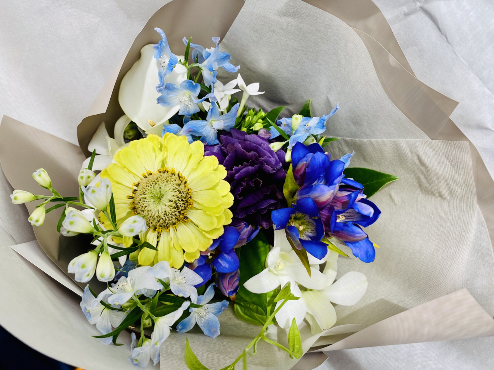
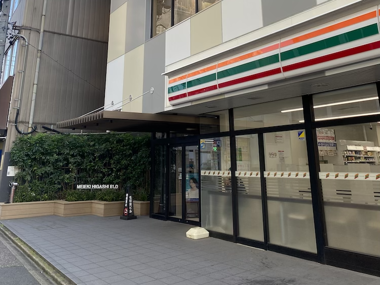

2022 年 11 月 10 日をもって [株式会社クラッソーネ](https://www.crassone.co.jp/) を退職しました。
正確には月末までは有給休暇を取らせていただいてますが、仕事をするのは昨日が最終日でした。

2020 年の 6 月にジョインしたので、クラッソーネには 2 年半くらい在籍していたことになります。
大変だった一方で本当にさまざまな経験をさせていただき、感謝しかありません。

## クラッソーネでどんな仕事をしてきたの？

挙げるとキリがないですが、こんな感じのことをしてきました：

- Rails アプリ / React アプリの開発（Ruby や Rails のバージョンアップもしてきました）
- 要件の整理とそれにともなう社内メンバーへのヒアリング
- オンコール対応
- 不具合報告や仕様の質問など、社内外からの問い合わせの対応
- スクラムマスター（っぽい改善施策の実施）
- Notion の活用など社内の業務インフラの整備
- エンジニア採用（とくにカジュアル面談）
- [クラッソーネ開発者ブログ](https://tech.crassone.jp) の立ち上げ（ブログエンジン作り）や記事の執筆
- プロダクトマネジメント

もちろん自分一人ですべて行ったわけではなく、どの課題も周囲の方を巻き込みながら取り組んできました。
ただ、その中でもちょっとハードルが高い「取り組みはじめる最初の一人」になることが多かったような気がします。

## どうして転職をするの？

仕事やキャリアについての悩みを 1on1 で社内の方に相談したところ、『嫌われる勇気』という本を紹介していただきました。
アドラー心理学について述べられた有名な本ですが、私自身は読んだことがありませんでした。

[嫌われる勇気 自己啓発の源流「アドラー」の教え](https://www.amazon.co.jp/dp/4478025819)

物語の後半に「人生とは連続する刹那である」という表現が出てきました。
人生とは旅のようであり、どこかの目的地に到達できたかどうかは重要ではなく、目的地に向かって進むその刹那の連続こそ大切だということです。

<blockquote class="twitter-tweet" data-conversation="none" data-lang="ja">
目的論、考えれば考えるほどわからんな… すべてがこれに帰する… 「人生とは連続する刹那である」というのは理解できるけど、じゃあどう生きていくか、みたいな…。（別に思い詰めてるわけではないです、あしからず）
— 山口 拓弥 (@yamat47) <a href="https://twitter.com/yamat47/status/1566792157675286528">2022年9月5日</a></blockquote>

<blockquote class="twitter-tweet" data-conversation="none" data-lang="ja">
今日もまた、目的論について考えてたらカフェの閉店時間になった…。 「僕がいま踊っているダンスは何？」次もまた同じダンスを踊るの？」このダンスを踊り続ける先には何がありそう？」みたいなことをぐるぐる考えてる。何となく、いまもう一度『７つの習慣』を読むべきなきがしてきた。
— 山口 拓弥 (@yamat47) <a href="https://twitter.com/yamat47/status/1567155014036238336">2022年9月6日</a></blockquote>

<blockquote class="twitter-tweet" data-conversation="none" data-lang="ja">
みんなは、どんな刹那を生きてるの…？（唐突）
— 山口 拓弥 (@yamat47) <a href="https://twitter.com/yamat47/status/1567158178529579008">2022年9月6日</a></blockquote>

改めて自分を見つめ直したときに、自分が大好きなテクノロジーが全面に表れるような何かに携わりたいと思いました。
「かがくのちからってすげー！」となるような何かを作っていく過程に携わりたいということです。

それは別に Rails アプリじゃなくてもいいのですが...
直近自分が一番評価されるのは Rails の経験だろうということで、Rails を採用している会社さんを狙って転職をしようと決意しました。

## 次はどこで働くの？

[株式会社ワンキャリア](https://onecareer.co.jp/) さんに所属させていただくことになりました。
Rails で作られているアプリの開発に携わりつつ、チームのマネジメントに取り組むところからスタートするような見通しです。

転職活動もいろいろあったのですが...
ここで書くと長くなってしまうので割愛します、気が向いたらまた書いてみます。

さまざまな会社さんに面談・面接などたくさんのお時間を割いていただきました。
本当に感謝しかないです、ありがとうございました。

## 11 月は何をしてすごすの？

来月から新しい会社で働くので、今月の残りは自由に過ごすつもりです。
コロナの様子も窺いつつ、旅行に行ったり映画を観たり運動したり...
積ん読もたくさんあるので、どんどん読んで一回り強くなって、初出社の日に備えるつもりです。

ただ夜はめっちゃ暇なので、ぜひ気軽にご飯とか誘ってください！
