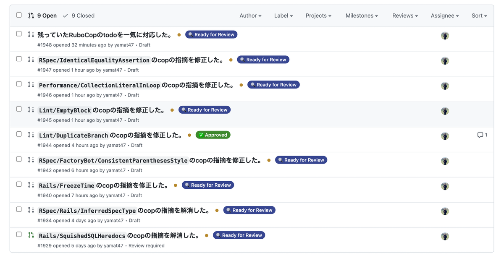
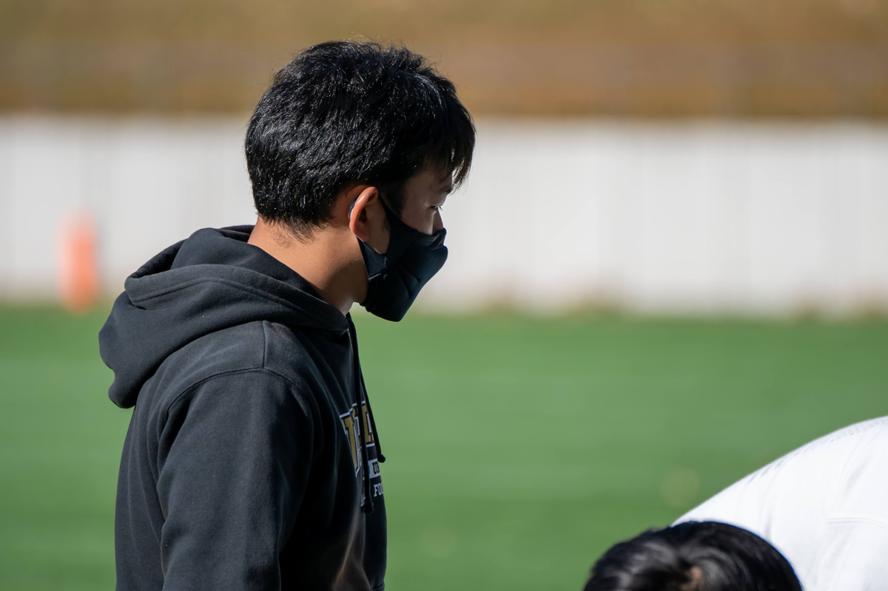
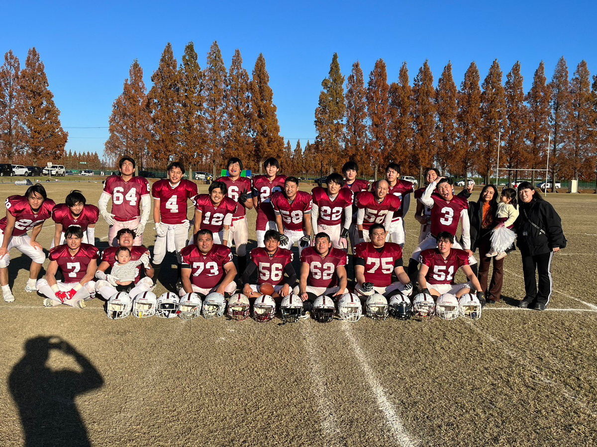

もうすっかり年の瀬ですね。年末に振り返りをすることってあんまりなかったのですが、転職して一ヶ月経ったということもありいろいろまとめてみます。

[29歳になりました](../2022-06-02-turning-29/index.md)

この記事を書いてからまだ半年くらいしか経ってないのか... とっても濃い一年でした。

## 仕事の話

### 4 月から突然プロダクトマネージャーを務めることになった

社内のいろんな事情があって PdM にジョブチェンジをしたのが今年の 4 月。「事業とエンジニアリングの連結」みたいな領域はそれまでまったく学習してこなかったので... 突然の連絡だったというのもあり、しばらくはびっくりして全然仕事が手についてなかったのを覚えています。

とりあえずたくさんの本を読むところから始めた記憶。「ビルドトラップ本」はやっぱりいい本でした。『ラディカル・プロダクト・シンキング』も大好きな本になりました。

<blockquote class="twitter-tweet" data-conversation="none" data-lang="ja">
一億回頷いてて首取れそう <a href="https://t.co/YUmYOuTWYQ">pic.twitter.com/YUmYOuTWYQ</a>
— 山口 拓弥 (@yamat47) <a href="https://twitter.com/yamat47/status/1529379154986434560">2022年5月25日</a></blockquote>

<blockquote class="twitter-tweet" data-conversation="none" data-lang="ja">
一通り読んだ。熱血な本だったな、好き嫌いがめっちゃ分かれそう（僕は好き）。  要所で局所最適と全体最適の話が出てきて、PdM は考え続けなくちゃいけない課題だと再認識した。「直近の利益 vs. 数年先の利益」「会社の利益 vs. 社会・世界の利益」みたいな話っていろんなことにつきまとう。
— 山口 拓弥 (@yamat47) <a href="https://twitter.com/yamat47/status/1538854634638680064">2022年6月20日</a></blockquote>

<blockquote class="twitter-tweet" data-conversation="none" data-lang="ja">
組織に余裕がまったくないと、どうしても目の前の事象の最適化に陥ってしまう。だってそうじゃないと死んでしまうから。中長期で安定して幸せにすごすために、短期的な成功は自然と達成するような仕組み・文化・能力作りが必要なんだろうな。
— 山口 拓弥 (@yamat47) <a href="https://twitter.com/yamat47/status/1538854636182183936">2022年6月20日</a></blockquote>

<blockquote class="twitter-tweet" data-conversation="none" data-lang="ja">
まあでも、ビジョナリーなこの本に多少なりとも共感する人と一緒に働きたいな。また一つ好きな本が増えた 📚
— 山口 拓弥 (@yamat47) <a href="https://twitter.com/yamat47/status/1538854637616660480">2022年6月20日</a></blockquote>

### 転職をした

このあたり詳しいことは以前書きましたが、12 月に転職をしました。クラッソーネに勤めたのは約二年ほど、本当にお世話になりました。

[クラッソーネを退職しました](../2022-11-11-leaving-crassone/index.md)

転職活動は 8 月くらいからしていて、カジュアル面談を含めると 20 社くらいの方とやりとりをしていました。「いいね！」を通して資料に目を通したのは 100 社くらい。エージェントから転職ドラフトまでいろいろな媒体で取り組みましたが、今思えばもうちょっと絞ってもよかったかな。オファーをたくさんいただけたのもあったけど、断るのが心苦しすぎてちょっと体調崩してました。

またこのタイミングで自分のキャリアについて棚卸しをしてみました。「5 年後とか 10 年後とかにどんなことをしていたい？」みたいな話です。あんまり語るのは恥ずかしいので控えますが、それを踏まえるとチームのマネジメントに挑戦してみたくて、そういう機会に恵まれそうな会社に巡り会えたのがとてもよかったです。

『嫌われる勇気』をこの時期にはじめて読みましたが、自分の人生観にぜひ取り入れたい考え方でした。読むように勧めてくださったのは前職の CEO たる川口さんです、本当にありがとうございました！

<blockquote class="twitter-tweet" data-conversation="none" data-lang="ja">
『嫌われる勇気』を今更ながら読んだけど、あらためて考えてみると本当に難しいな アドラー心理学ってなんとなく理解してたつもりだけど、目の前の事柄に適用しようとするとまあ難しい👀
— 山口 拓弥 (@yamat47) <a href="https://twitter.com/yamat47/status/1566051009054801920">2022年9月3日</a></blockquote>

<blockquote class="twitter-tweet" data-conversation="none" data-lang="ja">
目的論、考えれば考えるほどわからんな… すべてがこれに帰する… 「人生とは連続する刹那である」というのは理解できるけど、じゃあどう生きていくか、みたいな…。（別に思い詰めてるわけではないです、あしからず）
— 山口 拓弥 (@yamat47) <a href="https://twitter.com/yamat47/status/1566792157675286528">2022年9月5日</a></blockquote>

### ワンキャリアで働きはじめた

12 月から実際に働きはじめたので、とりあえず一ヶ月が経ちました。まだまだわからないことはたくさんありますが、なりふり構わずいろいろなことをインプットしています。

ワンキャリアは [ONE CAREER](https://www.onecareer.jp/) をはじめとするさまざまなプロダクトを運用していて、R&D のチームも含めて大小さまざまなチームがあります。その中で僕は ONE CAREER 開発チームに所属することになり、前職から引き続きサービス提供の最前線で戦っています。

年内はアーキテクチャーの理解やチーム・会社の作法を学ぶような時間でしたが、年明けからは開発チームのマネジメントをしていきます。WIP を減らしてチームみんなで一つの物事に取り組む、そんなチームづくりが来年最初の課題です。詳しくはおそらく [会社のテックブログ](https://note.com/dev_onecareer/) とかで話すとは思うのですが、こんなところから挑戦していきます：

- DevOps の考え方をチームに根付かせる。インシデントやエラーの即応性の向上。
- ↑ を実現するための足元の仕組みづくり。CI を強化したりデプロイ・ブランチマネジメントを楽にしたり、feature toggle の仕組みを取り入れたり。

特に年内は RuboCop の todo を解消するおじさんになっていました。全部直して Draft なプルリクを作るところまでは進められたので、年明けにちょっとずつリリースしていきます。

## アメフト

### ヘッドコーチとして初めて関東選手権に進出しました

学生の頃に入っていたチーム（[VIKINGS](https://twitter.com/vikings_recruit?s=20&t=ggBRRLcJ3wHY5Dyj7-ag3w)）のヘッドコーチをするようになってもう 4 年くらい経ちますが、初めて関東選手権（プレーオフ）に進出することができました。学生の頃に出てから 8 年ぶりの出場、やっぱり駒沢でやるアメフトはいいものですね。

（こんな格好して指示を出したりタイムアウトを取ったりしてます）

### OL に挑戦したシーズン、やっぱりとっても大変でした

[BRANDINGS](https://twitter.com/Brandings_team) では今年も主将を務めましたが、人数不足により OL に挑戦せざるを得ず... 頭の使い方も体の動かし方も RB とはまったく違うポジションで、とても難しかったです。テクニックとかもありますがやっぱりパワーが一番で、どうしてもしんどい場面が多かったですね...。

チームは今年もプレーオフに進出するものの、一回戦で敗れてシーズンはすでに終了。自分自身も学生たちの試合と被って出られなかった試合も数多くあり、不完全燃焼な感は否めない一年でした。

（真ん中でボールを置いている 56 番の選手が僕です）

## その他

### Netflix でアニメやらドラマやらをちょこちょこ観るようになった

家族から「Netflix で観たい番組があるから入ってくれ」と言われたのが確か入ったきっかけだったけど、せっかくだしということで話題になっているものをいくつか観ています。

<blockquote class="twitter-tweet" data-conversation="none" data-lang="ja">
梨泰院クラス、すごく面白い（いまさら）
— 山口 拓弥 (@yamat47) <a href="https://twitter.com/yamat47/status/1586206595842646016">2022年10月29日</a></blockquote>

他にはベタだけど『SPY×FAMILY』とか『First Love 初恋』とか。去年まではドラマとかは全然観ていなくて、暇さえあれば本を読んだりコード書いたりしてました。それでもちょっと観てみるととても面白くて、話題になるだけあるなと。

映画も含めて、来年もほどほどに観るつもりです。歳をとるたびに人間らしさを取り戻している気がする...笑

<blockquote class="twitter-tweet" data-conversation="none" data-lang="ja">
『沈黙のパレード』よかったな… 物語が進展していく感じが小説のページをめくっていくような雰囲気でどんどん引き込まれたし、なによりストーリーがとってもよかった… 福山雅治かっこいい…
— 山口 拓弥 (@yamat47) <a href="https://twitter.com/yamat47/status/1581637617984360449">2022年10月16日</a></blockquote>

<blockquote class="twitter-tweet" data-conversation="none" data-lang="ja">
とってもいい映画だった🥲 ネタバレになっちゃうからあんまり書けないけど… すごく重たくてすごく暖かいストーリーでした。こういう話を実家で観てた高校生の頃から10年経って、全然違った感じを抱いてる😢 <a href="https://twitter.com/hashtag/%E3%83%A9%E3%83%BC%E3%82%B2%E3%83%AA%E3%82%88%E3%82%8A%E6%84%9B%E3%82%92%E8%BE%BC%E3%82%81%E3%81%A6?src=hash&amp;ref_src=twsrc%5Etfw">#ラーゲリより愛を込めて</a>
— 山口 拓弥 (@yamat47) <a href="https://twitter.com/yamat47/status/1602684404044017664">2022年12月13日</a></blockquote>

### 『龍が如く』シリーズを初めてプレイした

<blockquote class="twitter-tweet" data-conversation="none" data-lang="ja">
龍が如く７、クリアした… なんだこのストーリー、龍が如くって全部こんなんなのか… すごいよかった…
— 山口 拓弥 (@yamat47) <a href="https://twitter.com/yamat47/status/1602345363335438336">2022年12月12日</a></blockquote>

キムタクがでてくる LOST JUDGMENT は去年やりましたが、本家の『龍が如く』はやったことがありませんでした。極道ものって理由でちょっと敬遠していたんですよね、ストーリーはちゃんとしているのかな、みたいな。

ただやってみると予想を遥かに超えるいいゲームで。サブストーリーを全部クリアするくらいにはやり込みましたが、あっという間な感じでした。

ナンバリングでここまで続いているシリーズはやっぱり強いですね。続編が来年発売されるみたいなのも楽しみ。

### 推していたアイドルが引退（卒業）した

私立恵比寿中学というグループの柏木ひなたさんというアイドルをずっと推していましたが、今年でグループを脱退しました。大学生の頃からなのでもう 10 年以上応援していたことになりますね、感慨深いです。

<blockquote class="twitter-tweet" data-conversation="none" data-lang="ja">
12年間本当にありがとうございました みんなに出会えてよかったです  明日からの新・私立恵比寿中学も よろしくお願いいたします  またね  出席番号10番 柏木ひなた<a href="https://twitter.com/hashtag/%E6%9F%8F%E6%9C%A8%E3%81%B2%E3%81%AA%E3%81%9F%E5%8D%92%E6%A5%AD%E5%BC%8F?src=hash&amp;ref_src=twsrc%5Etfw">#柏木ひなた卒業式</a> <a href="https://t.co/MTjGy2YORa">pic.twitter.com/MTjGy2YORa</a>
— 柏木ひなた (@hi_99_na) <a href="https://twitter.com/hi_99_na/status/1603765751122636801">2022年12月16日</a></blockquote>

<blockquote class="twitter-tweet" data-conversation="none" data-lang="ja">
本当にありがとう🥹👏🏼 スカートの柄とチビひなに感動！！！！ <a href="https://t.co/bdUUl4EcbN">https://t.co/bdUUl4EcbN</a> <a href="https://t.co/AZzllrs86Y">pic.twitter.com/AZzllrs86Y</a>
— 柏木ひなた (@hi_99_na) <a href="https://twitter.com/hi_99_na/status/1603239395171368960">2022年12月15日</a></blockquote>

バイトやアメフト、仕事で辛いときには必ずエビ中の曲を聴いて乗り越えてきた 20 代。一回くらい紅白歌合戦に登場する姿をみたかったなと、年の瀬になると感じずにはいられません。

引き続きアーティストとして活動し続けるらしいので、今後の活躍に期待してます！

<blockquote class="twitter-tweet" data-conversation="none" data-lang="ja">
推し（の衣装と写真たち）に会ってきた🍤🦐 卒業まであと4ヶ月くらい、最後まで全力で駆け抜けてください…！ <a href="https://twitter.com/hashtag/%E3%82%82%E3%81%A3%E3%81%A8%E3%82%A8%E3%83%93%E5%B1%95?src=hash&amp;ref_src=twsrc%5Etfw">#もっとエビ展</a> <a href="https://t.co/nZONnpZJgH">pic.twitter.com/nZONnpZJgH</a>
— 山口 拓弥 (@yamat47) <a href="https://twitter.com/yamat47/status/1560902500274044928">2022年8月20日</a></blockquote>

## 最後に

たくさんの方に支えられて、なんとか今年も年を越せそうです。本当にありがとうございました！

来年は 30 歳になる節目の年なので、より一層いろんなことに挑戦する楽しい一年にするつもりです。東京にいる時間がほとんどだと思いますので、ご飯でもお酒でもなんでもいつでも誘ってください！
