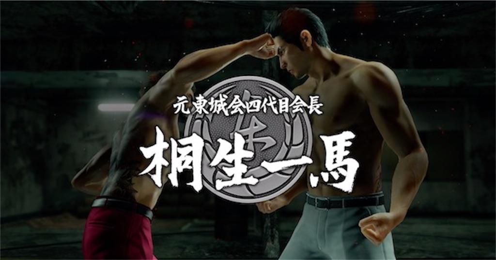
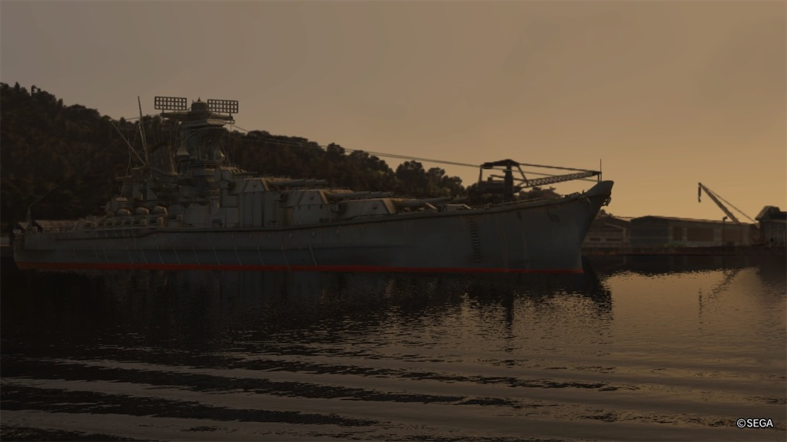
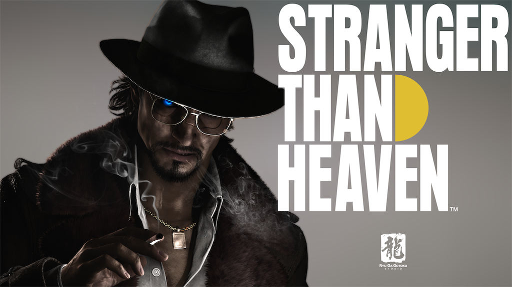

『LOST JUDGEMENT』を 2021 年に遊んだのがきっかけで、「龍が如く」を少しずつプレーしてきた。一部のタイトルはゲーム実況を観たりしながらようやくナンバリングにすべて触れたので、一区切りなエントリーを書いてみる。

#### そもそも『LOST JIDGEMENT』がとても面白かった

入りはいわゆる「キムタクが如く」だったが、軽快なアクションや豊富なおまけ要素、なにより重厚なストーリーがとても面白かった。「ああーこういう結末かな」と想像したところから二回転くらい回っていく、そして決して大団円には終わらない。何から何まで自分好みなテイストだった。

https://judgment.sega.com/

主題歌の『螺旋』もストーリーのドロドロ感をそのまま表したような、とてもよい曲だった。

https://www.sega.jp/topics/detail/210707_2/

#### 『7』が龍が如くの入り口だったが、いろんな意味でちょうどよかったと思う

当然だが、ナンバリングのタイトルは以前の作品からストーリーが続いていく。7 も、6 での尾道での一件を前提にした 2020 年頃の話。

ただ 7 は主人公の交代やバトルシステムの刷新など、様々な点でリニューアルされたタイトルだった。主要キャラは初登場する人が大半で、過去の深掘りなどストーリー中に丁寧に描かれていた記憶がある。この辺りは 8 とごちゃ混ぜになっているかも知れないが、何にせよ新参者でも始めやすかったと記憶している。

https://ryu-ga-gotoku.com/seven/

#### 「背景を知ったら実は何十倍も面白いのでは？」と、ゲーム実況を介して感じていた

僕は牛沢というゲーム実況者のファンで、ニコニコから YouTube に移ってきた辺りから動画を観ている。

https://www.youtube.com/@uszw/playlists

他の実況者の動画を観ないこともないが… 醸し出す独特の雰囲気（三下感）とかストーリーへの入り込み方がちょうど良くてもうずっと追いかけている。

そんな牛沢の 7 の実況を観ると、同じシーンでも自分と感想が全然違っていることに気付く。途中で桐生が渡瀬の一味として助けにくるシーン、大声を出して驚いていたが、6 をプレーした後だとあの感情がとてもよくわかる。

「これがナンバリングを積み重ねて来たタイトルの重みだよなー」と改めて感じた瞬間だった。

#### 7 外伝を経て 8 をプレー、エンディングノートで過去の深さを感じた

そもそもゲームが面白かったので、続編が出るたびにすぐに買ってプレーをしていた。7 外伝、8、8 外伝とプレーして、そこそこのレベルにはやり込んでいた。

https://ryu-ga-gotoku.com/gaiden/

https://ryu-ga-gotoku.com/eight/

https://ryu-ga-gotoku.com/pirate/

極め付けは 8 のエンディングノート作りで、過去シリーズに登場した様々なキャラクターと一緒に人生を振り返っていくような仕組みのシステム。「こんな人たちとこれまで過ごして来たんだな」と想像はできるが… やっぱり全然わからない人もたくさんいて…

そして 1（時系列的には 0 から）から順々にストーリーを追いかけてみよう、と一念発起した。大したことではないが。

#### 知れば知るほど、桐生一馬の魅力に魅了されるシリーズだった

極、極2、極0、3、4、5、6 という順番でストーリーを追いかけて行った。

極2と6は自分でプレーしたが、その他は牛沢のゲーム実況を観ていった。時間がなかなか取れなかったのもあるが… 昔のタイトルだと操作感がイマイチでどうしても続かなかったのもある。改めて、デジタルリマスターはとってもありがたい。

https://www.nicovideo.jp/user/12906136/mylist/24818058

知れば知るほど、桐生一馬の魅力に魅せられるシリーズだった。シリーズをやりつづけている人は似たような感想になるだろうが… あの無鉄砲さや強さには何とも言えない憧れを覚える。もちろん、自分があんなにぶん殴ったりしたいわけではないが。

話の展開はぶっ飛んでるなーと思うことも多いけど… どこか人間臭さもあったり、意外と現実とニアミスしていたり。それにしても尾道の港から超弩級の戦艦が突如現れたのには笑ってしまった。

そんなこともありつつ… 8 外伝の時点では桐生一馬の物語はかなり終わりに近いように感じながら、続編を待つ今日この頃。

#### 兎にも角にもとっても面白かった

…からこそこんな文章を勢いに任せて書いているのだが。こんなシリーズに出会えてよかった。

ここから先はどうなっていくだろうか。

Project Century なるプロジェクトが動いているとのことで、少しずつ情報がオープンになっている。どんなものになるかとても楽しみだし、それまではまたプレーしてみたら実況を見返したりで、この作品の世界を感じていよう。

