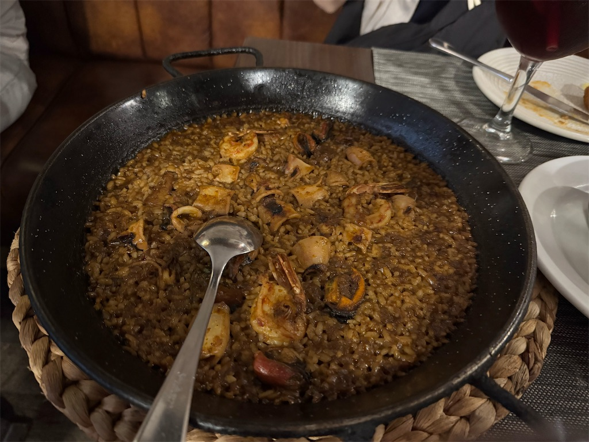

年が明けてしまっているが、今年も一年の振り返りをやってみる。毎年同じことを言っている気もするが、いろいろあった年なのでそれを思い出す意味でも。

#### 結婚式を挙げた

4月に汐留で結婚式をして、多くの人に来ていただいた。準備は9月ごろから少しずつはじめていたが、本格化した1月以降はさすがに毎週末バタバタしていた。

同僚から「結婚式は、人生でおそらく唯一、全員があなたのために集まってくれる場。とってもハッピーな場だから遠慮せず楽しんでください」といった旨の言葉をいただいて、本当にその通りだった。たくさんの祝福をいただいて、その後の二次会・三次会含めて最高の一日だった。

新婚旅行ではイタリアやスペインに一週間ほど行かせていただいた。本場のパエリアは別格だったし、ベネチアでゴンドラに乗る体験も叶ってとてもよかった。初めての海外だったが意外と何とかなったので、またどこか行こうかなーと計画中。

#### 部長になり、権限も責任もまた一段階大きくなった

5月に所属していた部署の分割があり、分割されたうちの一つの部長を務めることになった。プロダクト開発部で、プロダクトエンジニア・デザイナー・プロダクトマネージャーを抱えている。

プロダクトマネージャーはまだ過去に経験があったが、デザイナーに関しては自分自身は経験したことがない。そんな中で人事評価などを行うために、自分なりに様々準備したのを覚えている。

メンバーのマネジメントをする際、自分は「年収 1000 万円までのキャリアパスを想定できるか」を大切にしている。マネージャーたるもの部下を引き上げてこそだと思っているし、そうでないと新卒採用でも中途採用でも優秀な方に魅力的なオファーができない。その意味で Cocoda は他社のデザイン組織に関する事例が様々載っていてとても参考になった。

https://cocoda.design

#### カンファレンスに初めて登壇をした

スポンサーセッションではあったが、縁あってカンファレンスで 40 分枠で登壇をした。夏頃にあった開発生産性カンファレンスにて、「開発生産性ではなくもっと素朴に事業の生産性を考えよう」というテーマで話した。

<blockquote class="twitter-tweet" data-conversation="none" data-lang="ja">
夏にある「開発生産性カンファレンス」にてお話させていただくことになりました。私のセッションは朝早いですが、皆さまぜひご参加ください！  「開発生産性」ではなく、事業の投資対効果に向き合う「事業生産性」へ <a href="https://t.co/qtS934ytQe">https://t.co/qtS934ytQe</a> <a href="https://twitter.com/hashtag/%E9%96%8B%E7%99%BA%E7%94%9F%E7%94%A3%E6%80%A7con_findy?src=hash&amp;ref_src=twsrc%5Etfw">#開発生産性con_findy</a>
— 山口 拓弥 (@yamat47) <a href="https://twitter.com/yamat47/status/1913219843953942560">2025年4月18日</a></blockquote>

当日の様子はアーカイブが出ていたり、記事にまとめていただいたりもしてありがたい。CfP を他にもいくつか応募したけど通らなかったな、2026年も登壇を狙います。

https://findy-tools.io/articles/onecareer-dev-productivity-con-2025/115

#### プロダクトマネジメントに仕事の比重をずらしはじめた

秋頃から、中途事業のプロダクトマネジメントを担うようになっている。たまたまだがトッププロダクトマネージャーの方から様々教えていただく機会をいただき、特にジョブ理論や PRFAQ について意識することが増えた。

<blockquote class="twitter-tweet" data-conversation="none" data-lang="ja">
ジョブ理論について最近深く教えていただいて、仕事にすぐ活かせそうでとてもいい学びになっている。「解決したい課題は何なのか」っていうとそれだけなのだが、これをちゃんと理解しようと思うと様々な思考の広げ方があって、基礎知識の大切さを改めて実感。
— 山口 拓弥 (@yamat47) <a href="https://twitter.com/yamat47/status/1996556026058072240">2025年12月4日</a></blockquote>

これまでも「作り手の論理に終始しない」などの形で意識したことはあったが、その練度や精度を高められている。ツイートの通りだが、基礎知識の大切さをこの歳になっても改めて実感している。

#### コーディングエージェント然り Figma Make しかり、LLM のパワフルさに驚かされる日々

世の中でこれほど騒がれているので今さらいうこともないが… Claude Code でコードを書いたり Figma Make でプロトタイピングをしたりと便利に使っている。Gemini や ChatGPT で調べることばかりだし、Deep Research で様々な情報源の情報をまとめたり NotebookLM にまとめてもらったり。

ツールに振り回されるのは避けたいと思っているが、便利に使えると強力だなと思いつつ Claude Code の情報だけは追いかけている。そうこうしていたら Bun のエンジニアももう Claude Code の改善に取り組んでいるようで、開発スピードにも納得。

Zero Config にうまく動くツールも増えてきて、世の中に膾炙した 2025 年。来年はまた違ったパラダイムが出てくるだろうのを今から楽しみにしている。

<blockquote class="twitter-tweet" data-conversation="none" data-lang="ja">
結局は Claude Code よ  ------- いつも使っているAIツールをまとめてみました！   <a href="https://t.co/bXG0ggu0Hr">https://t.co/bXG0ggu0Hr</a>   <a href="https://twitter.com/hashtag/Findy?src=hash&amp;ref_src=twsrc%5Etfw">#Findy</a>  <a href="https://twitter.com/hashtag/Findy_AI_Career?src=hash&amp;ref_src=twsrc%5Etfw">#Findy_AI_Career</a>  <a href="https://twitter.com/hashtag/AI%E3%83%84%E3%83%BC%E3%83%AB%E3%83%9D%E3%83%BC%E3%83%88%E3%83%95%E3%82%A9%E3%83%AA%E3%82%AA?src=hash&amp;ref_src=twsrc%5Etfw">#AIツールポートフォリオ</a>
— 山口 拓弥 (@yamat47) <a href="https://twitter.com/yamat47/status/1991626822765932639">2025年11月20日</a></blockquote>

#### 将来のお金の計画を真剣に考えはじめた

…といっても、ライフプランを伝えつつ FP の方に相談しただけと言えばそうだが。ただそれでも例えば「家を買うなら、年収と購入額とのバランスはどうなるのか？」「子どもを考えるとしたらどう影響があるのか？」「老後までのキャッシュフローに問題はあるのか？」など整理してもらえてよかった。

結局「餅は餅屋」というか、お金をもらうプロフェッショナルたる所以を感じていた。それにしてもまだまだ稼がなくちゃいけないこともわかったので、仕事がんばるぞー

#### 昔の振り返り

[2024年を振り返ってみる](../2024-12-31-looking-back-on-2024/index.md)

[2022年を振り返ってみる（仕事、アメフト、Netflix、推し活、...）](../2022-12-31-looking-back-on-2022/index.md)
